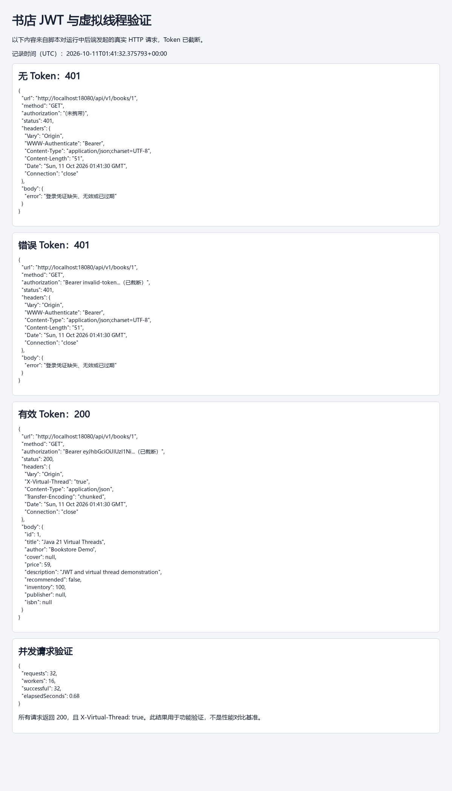

# 应用系统体系架构：作业 4

## 运行

使用 Java 21 和 Spring Boot 3.2.5。项目根目录的 `.sdkmanrc` 固定 SDKMAN 版本。

```bash
sdk env
java -version
./scripts/run-jwt-demo.sh
```

脚本生成随机 JWT 密钥，启用独立 H2 内存数据库，不访问现有 MySQL 数据。演示账号：

| 用户名 | 密码 | 身份 |
|---|---|---|
| demo | demo123 | 普通用户 |
| admin | admin123 | 管理员 |

演示数据仅在 `demo` profile 加载；每次重启重建。演示图书 ID 为 1。
前端在另一终端执行 `cd frontend && npm install && npm run dev`，访问 `http://localhost:5173`。

使用原有 MySQL 模式时：

```bash
sdk env
export JWT_SECRET="$(openssl rand -base64 32)"
export DB_PASSWORD='你的数据库密码'
# 可选：export DB_URL='jdbc:mysql://localhost:3306/bookstore?...'
cd backend
./mvnw spring-boot:run
```

本地 `backend/application-local.properties` 的同名配置会覆盖主配置，检查其中的数据库地址是否正确。
多实例部署必须配置同一个固定的 JWT_SECRET，不能每台实例分别生成。密钥为至少 32 字节随机数据的 Base64 编码。
IDE 的 Project SDK 和 Maven Runner 也要使用 Java 21。

## REST 接口与认证

- `POST /api/v1/users/login`：JSON 用户名、密码；验证通过返回用户信息及 `token`、`tokenType`、`expiresIn`。
- `POST /api/v1/users/register`：公开注册接口。
- `GET /api/v1/books`：图书列表，可加 `?title=Java`。
- `GET /api/v1/books/{id}`：图书详情，存在返回 200，缺失返回 404。
- 图书新增返回 201 和 Location；部分修改可使用 PATCH；保留旧 `/book` 和 PUT 路径以兼容已有调用。
- 其余 API 需要 `Authorization: Bearer <JWT>`。

`JwtService` 使用 JJWT 0.13.0 签发 HS256 JWT，包含 sub、identity、iss、aud、iat、exp、jti。
`JwtInterceptor` 只接受 HS256，验证签名、有效期、签发者、接收者和合法用户 ID。
缺少、错误、篡改、过期的凭证统一返回 JSON、HTTP 401 和 `WWW-Authenticate: Bearer`。
有效身份访问无权限资源返回 403。

鉴权通过后查询数据库中的当前账号状态及角色，让禁用和角色变更立即生效；将 userId、identity 写入当前 request。
没有 HttpSession、JSESSIONID 登录 Cookie 或服务端登录表。购物车和订单按已验证的用户身份检查归属，创建时不信任客户端 userId。
JWT Payload 可被读取，不能存密码。前端将访问凭证保存在 localStorage 中；401 会清理凭证并更新路由守卫。
localStorage 中的凭证可被页面脚本读取，因此正式上线仍需做好 XSS 防护和 HTTPS。
退出登录清除本地凭证，不撤销已签发 Token；默认有效期为一小时，可用 JWT_TTL_SECONDS 配置。

## 虚拟线程与慢 I/O

`pom.xml` 的 java.version 为 21；主配置设置 `spring.threads.virtual.enabled=true`。
图书详情在处理请求的线程上记录 `Thread.currentThread().isVirtual()`，并返回 `X-Virtual-Thread: true` 作为验证证据。
演示配置通过 `Thread.sleep(300)` 模拟 I/O 等待，默认 MySQL 模式不增加等待，可用 BOOK_QUERY_DELAY_MS 配置。
线程等待被中断时恢复中断标志。数据库连接池仍会限制真实数据库并发，虚拟线程不保证单次查询更快。

## 验证和截图

启动演示后，在项目根目录执行：

```bash
python3 scripts/verify-jwt.py
```

脚本真实请求后端，验证无 Token 401、错误 Token 401、登录后带 Token 200，以及并发请求的虚拟线程。
输出 `docs/evidence/jwt-verification.json` 和 HTML 报告，Token 只保留前缀。
打开 HTML 报告即可截图。也可以用 Postman 或终端截图：

```bash
# 401：没有凭证
curl -i http://localhost:8080/api/v1/books/1

# 登录，复制 JSON 中 token 字段
curl -i -X POST http://localhost:8080/api/v1/users/login \
  -H 'Content-Type: application/json' \
  -d '{"username":"demo","password":"demo123"}'

# 200：将下面占位内容替换为实际凭证
curl -i http://localhost:8080/api/v1/books/1 \
  -H 'Authorization: Bearer <登录返回的token>'
```

截图应清楚展示 URL、请求凭证是否携带、HTTP 状态码和响应数据，200 响应同时包含虚拟线程证据。
并发脚本用于证明功能可用，不能当作平台线程与虚拟线程的性能对比。
自动化测试见 [TESTING.md](TESTING.md)，包含真实 Tomcat HTTP 集成测试。

本次验证使用独立演示服务的 18080 端口，实际响应记录见 [JSON](evidence/jwt-verification.json) 和 [HTML](evidence/jwt-verification.html)。
后端 79 个测试、前端 46 个测试通过，前端构建成功。并发脚本的 32 个请求全部返回 200 与虚拟线程标记。



## 提交

```bash
./package_submission.sh
```

脚本按明确列表收集源码、构建配置、数据库脚本、文档、验证证据；排除 JAR、class、依赖目录、构建产物及本地密钥文件。
不提交整个工程目录或可执行 fat JAR。Maven Wrapper JAR 不包含在压缩包内，构建时由 Wrapper 自动下载，或使用已安装的 Maven。

## 对应评分项

| 项目 | 对应实现 |
|---|---|
| RESTful 图书查询 | BookController，GET /api/v1/books/{id} |
| Java 21 虚拟线程 | pom.xml、application.properties、真实 HTTP 线程检查 |
| JWT 库与签发 | JJWT 依赖、JwtService、登录响应 |
| 无状态鉴权 | JwtInterceptor、WebConfig、请求级用户身份 |
| 401 / 200 证据 | scripts/verify-jwt.py、docs/evidence、集成测试 |

参考：[Spring Boot 虚拟线程配置](https://docs.spring.io/spring-boot/docs/3.2.5/reference/html/features.html#features.spring-application.virtual-threads)、[JJWT 官方说明](https://github.com/jwtk/jjwt)。
